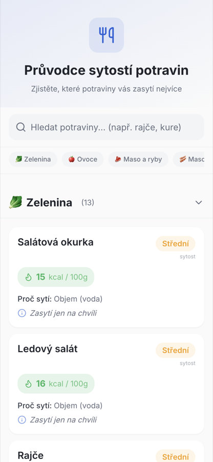

# Kalorie potravin

**Průvodce sytostí potravin** — a mobile-first web app (in Czech) that shows calories per 100 g and how filling each common food is. It is built to help people pick food that keeps them full on fewer calories.

**Live app:** https://romanzdk.github.io/kalorie-potravin/



## Features

- ~90 common foods grouped by category (vegetables, fruit, meat, dairy, …)
- calories per 100 g and a colour-coded satiety level (high / medium / low) with the reason (fibre, protein, volume)
- search that ignores case and Czech diacritics (`rajce` finds *Rajče*, `kure` finds *Kuřecí*)
- static site: no account, no backend, no cookies; visits are counted with cookieless [GoatCounter](https://www.goatcounter.com/) (remove the script in `index.html` if you fork it)

> Values are indicative and were generated with AI (Gemini 3, 12/2025). They have not been checked against an official food database.

## Development

Requires Node.js 22+.

```sh
npm ci
npm run dev      # http://localhost:8080/kalorie-potravin/
npm run lint
npm run build    # static site in dist/
```

The food data lives in [`src/data/foods.ts`](src/data/foods.ts).

Built with React, TypeScript, Vite, Tailwind CSS and shadcn/ui. The first version was generated with [Lovable](https://lovable.dev).

## Deployment

Every push to `main` builds the app and deploys it to GitHub Pages ([`.github/workflows/pages.yml`](.github/workflows/pages.yml)). Pull requests run lint, type check and build. In a fork, set **Settings → Pages → Source** to **GitHub Actions** first.

## License

[MIT](LICENSE)
